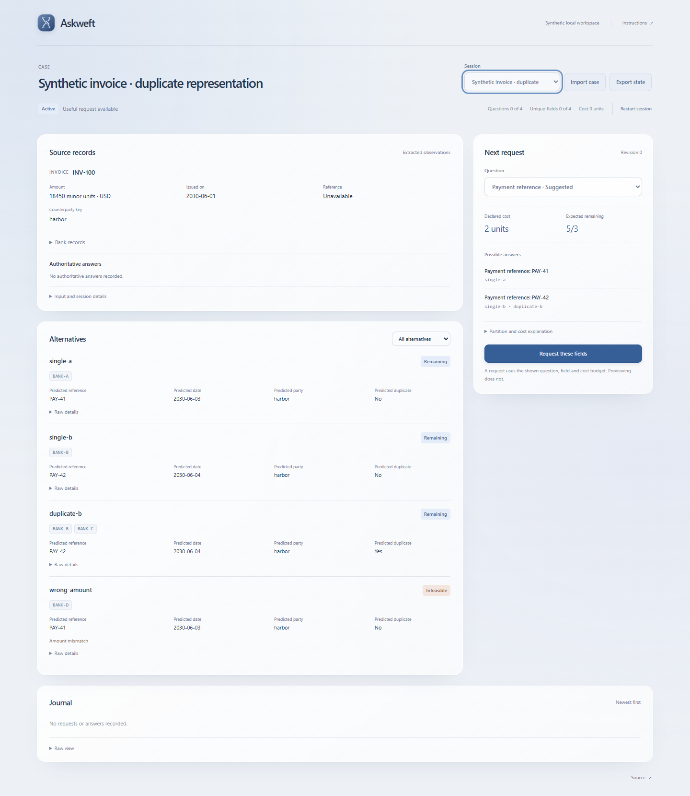

# Askweft

Document clarification planning over extracted invoice and bank-event JSON. Askweft shows
competing record groups, ranks field requests by exact expected elimination per declared
cost, records typed answers and preserves unresolved cases in a local SQLite journal.

Python 3.11 or newer; no runtime dependencies.

[Recorded example](https://bglglzd.github.io/askweft/) ·
[Release packages](https://github.com/bglglzd/askweft/releases/tag/v0.1.0)

## Run locally

```sh
git clone https://github.com/bglglzd/askweft.git
cd askweft
python -m venv .venv
.venv/bin/python -m pip install .
.venv/bin/askweft --db example.sqlite demo
```

On Windows use `.venv\Scripts\python.exe` and `.venv\Scripts\askweft.exe`. Open the printed
numeric loopback URL. The synthetic example is seeded only when the database has no sessions.
Ctrl+C stops the server. Use a fresh database path to start again.

Request **Payment reference**, answer `PAY-42`, then request **Duplicate bank records**
and choose Yes. Inspect the surviving group and its two answer receipts. The hosted example
lets you inspect six saved engine stages; local operation accepts your own inputs and answers.

Import your own Case v1 JSON through the local UI or `askweft --db work.sqlite import case.json`.
Inspect the candidate partitions, explicitly request a field and provide its actual value
or unknown. An answer outside all candidates stays unresolved. Restarting creates a new
session from retained source bytes and preserves the old answers.



## Scope

One invoice, up to 16 bank events and 16 explicit alternatives. USD/EUR/GBP; integer minor
units; exact, case-sensitive comparisons. A group with multiple records describes duplicate
representation of one payment, never a summed split payment.

One survivor is resolved **within the supplied model**. An unseen truth can mimic an included
candidate. This is not document authentication, financial approval, OCR or a live bank feed.
Question costs are declared units, not measured operator time or money.

The first synthetic comparison used 30 development, 10 held-out and 8 separate stress inputs.
On the 10 held-out inputs at the standard cost setting, adaptive and fixed each resolved
7 correctly and left 3 unresolved; no wrong resolution occurred. Default held-out advantage
over fixed was not established. [Full effort, sensitivity, denominators and limits](docs/evaluation.md).

[Case/request specification](docs/spec.md) · [Architecture](docs/architecture.md) ·
[Operations and recovery](docs/operations.md) · [Evaluation replay](docs/evaluation-replay.md) ·
[Related products](docs/comparison.md) · [MIT license](LICENSE)
