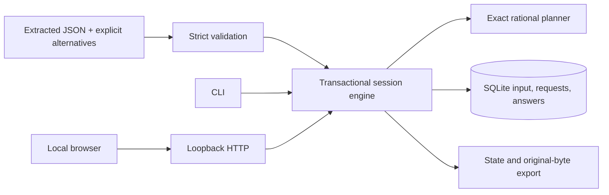

# Architecture

`domain.py` owns types, normalization, financial feasibility and derived predictions.
`planner.py` is a pure calculation over current known/unavailable fields and budgets.
`store.py` owns the SQLite transaction, revision check, immutable request snapshot and answer
receipt. Each operation opens its own connection; write transactions use `BEGIN IMMEDIATE`.
The revision predicate protects competing UI/CLI writers. Reads use a consistent transaction.

The HTTP layer serves bundled native assets on numeric IPv4 loopback. It validates Host,
Origin, a random in-memory mutation token, bounded JSON and closed route payloads. This is
a local operator tool, not a multi-user authentication system. No remote server, bank,
model/provider, OCR, browser-side scoring or runtime dependency is involved.

`worker.py` exposes the same engine to a separate synthetic evaluator. The worker receives
only case/config and the answer to an already selected pending request. Gold and future
answers stay in the evaluator. Static demo stages are recorded engine state; hosted browsing
does not run Python or accept mutations.
